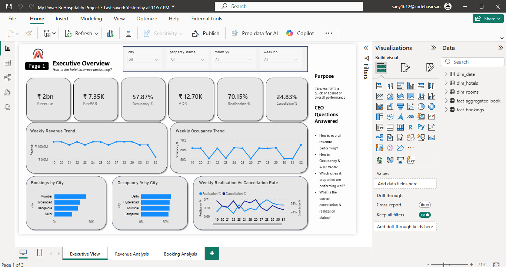
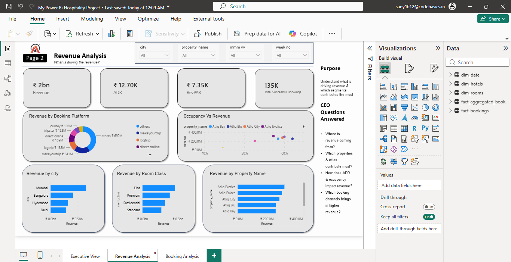
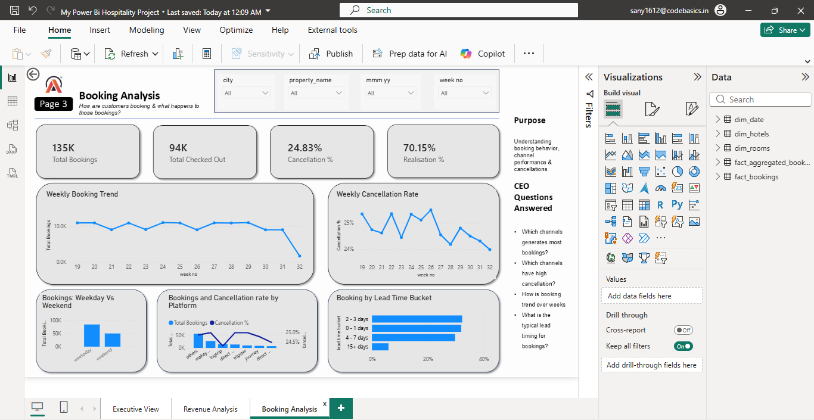

# 🏨 Hospitality Revenue & Booking Analytics — Power BI

A portfolio-ready **Power BI business intelligence project** built to help hospitality leadership understand revenue performance, occupancy, bookings, cancellations, customer booking behavior, and channel performance.

The dashboard is designed from a **CEO / management perspective**: each page has a clear business purpose, KPIs, and visuals intended to answer practical business questions rather than simply display data.

---

## 📊 Dashboard Preview

### 1. Executive View

The executive page provides a high-level snapshot of hotel performance and highlights the most important commercial KPIs and trends.



**Key metrics shown**
- Revenue
- RevPAR
- Occupancy %
- ADR
- Realisation %
- Cancellation %

**Questions addressed**
- How is the business performing overall?
- How are occupancy and ADR trending?
- Which cities/properties are performing well?
- What is the current cancellation and realisation status?

---

### 2. Revenue Analysis

The revenue page focuses on **where revenue is coming from** and how it varies across properties, cities, room classes, booking platforms, and occupancy.



**Key metrics shown**
- Revenue
- ADR
- RevPAR
- Total Successful Bookings

**Questions addressed**
- Which booking platforms generate the most revenue?
- Which cities contribute the most revenue?
- Which properties generate the highest revenue?
- How does occupancy relate to revenue?
- Which room classes contribute more revenue?

---

### 3. Booking Analysis

The booking page focuses on **customer booking behavior, cancellations, booking timing, and weekday/weekend demand**.



**Key metrics shown**
- Total Bookings
- Total Checked Out
- Cancellation %
- Realisation %

**Questions addressed**
- Which channels generate the most bookings?
- Which channels have higher cancellation?
- How does booking volume change by week?
- What is the typical booking lead time?
- Is demand different between weekdays and weekends?

---

## 🎯 Business Objectives

1. **Measure overall hotel performance**
2. **Understand revenue drivers**
3. **Identify high-performing cities, properties, and room classes**
4. **Understand booking and cancellation behavior**
5. **Translate data into management-level business questions and insights**

---

## 💡 Key Business Areas Covered

| Area | Analysis |
|---|---|
| Revenue | Revenue by city, property, room class and booking platform |
| Pricing | ADR and RevPAR |
| Occupancy | Occupancy trends and occupancy vs revenue |
| Bookings | Weekly booking trends and booking volume |
| Channels | Booking platform performance |
| Cancellations | Cancellation rate and platform-level cancellation |
| Customer behavior | Lead-time bucket analysis |
| Demand pattern | Weekday vs weekend bookings |
| Operations | Realisation and successful bookings |

---

## 📌 KPI Snapshot

The dashboard snapshot currently displays metrics such as:

- **Revenue:** ₹1.7B+
- **RevPAR:** ₹7.35K
- **Occupancy:** 57.87%
- **ADR:** ₹12.70K
- **Realisation:** 70.15%
- **Cancellation:** 24.83%
- **Total Bookings:** 135K
- **Total Checked Out:** 94K

> Values above are the figures visible in the dashboard screenshots and may change when the report is refreshed or filtered.

---

## 🔎 Selected Dashboard Observations

- Mumbai is the strongest city among the displayed city rankings.
- Atliq Exotica appears as the highest-revenue property among the displayed properties.
- Elite is the leading displayed room class by revenue.
- Weekday bookings are higher than weekend bookings in the displayed comparison.
- The **2–3 day** lead-time bucket has the highest displayed booking share.
- Cancellation rates fluctuate across weeks, making weekly monitoring useful.
- Booking platforms show different revenue and cancellation patterns, creating opportunities for channel-level strategy.

These are **dashboard-level observations**, not causal conclusions.

---

## 🧮 Technical Implementation

### Power BI
- Dashboard design and storytelling
- Interactive slicers
- KPI cards
- Bar charts
- Line charts
- Scatter chart
- Donut chart
- Combo chart
- Cross-filtering

### Power Query
Used for data preparation and transformation, including:
- Data cleaning
- Date transformation
- Custom columns
- Data-type handling
- Preparation of analysis-ready fields

### DAX
Used for dynamic business metrics and analytical calculations, including:
- Revenue
- ADR
- RevPAR
- Occupancy %
- Realisation %
- Cancellation %
- Total bookings
- Successful bookings
- Booking lead time / lead-time buckets
- Weekly analysis measures

### Data Model

The report uses dimensional and fact-style tables including:

- `dim_date`
- `dim_hotels`
- `dim_rooms`
- `fact_aggregated_bookings`
- `fact_bookings`

This structure supports reusable measures, filtering, and analysis across different business dimensions.

---

## 🗂️ Professional Project Structure

```text
hospitality-powerbi-analytics/
│
├── README.md
│
├── assets/
│   ├── executive-view.png
│   ├── revenue-analysis.png
│   └── booking-analysis.png
│
├── docs/
│   ├── business-questions.md
│   ├── data-model.md
│   └── insights.md
│
├── powerbi/
│   └── Hospitality_Revenue_Booking_Analytics.pbix
│
└── data/
    └── README.md
```

> The `.pbix` and source-data folders are shown as the recommended portfolio structure. Add those files only if you are comfortable sharing them publicly and the source data permits redistribution.

---

## 🧠 Business Questions → Dashboard Mapping

| Business Question | Page |
|---|---|
| How is the business performing overall? | Executive View |
| How are occupancy and ADR trending? | Executive View |
| Which cities generate the most revenue? | Revenue Analysis |
| Which properties generate the most revenue? | Revenue Analysis |
| Which room classes generate the most revenue? | Revenue Analysis |
| Which booking platforms generate the most revenue? | Revenue Analysis |
| How does occupancy relate to revenue? | Revenue Analysis |
| Which channels generate the most bookings? | Booking Analysis |
| Which channels have higher cancellation? | Booking Analysis |
| How do bookings change week by week? | Booking Analysis |
| What is the typical booking lead time? | Booking Analysis |
| Are weekday and weekend bookings different? | Booking Analysis |

---

## 🎨 Dashboard Design Approach

The report follows a consistent executive-dashboard layout:

- Clear page titles and subtitles
- KPI cards positioned at the top
- Trend analysis in the middle
- Category comparisons at the bottom
- Consistent spacing and alignment
- Consistent currency, percentage and decimal formatting
- Indian Rupee formatting for financial metrics
- Week numbers displayed chronologically
- A dedicated **Purpose** and **CEO Questions Answered** section on every page

The intention is to make the report understandable to a decision-maker without requiring them to know the underlying Power BI model.

---

## 🚀 What I Learned From This Project

This project helped strengthen practical skills in:

- Business problem understanding
- Data cleaning with Power Query
- Data modelling
- DAX measures and calculated columns
- Time intelligence and week-number handling
- KPI design
- Choosing the right visual for a business question
- Dashboard layout and visual hierarchy
- Executive storytelling
- Translating analysis into management questions

A major focus was learning **why a visual is needed**, rather than simply adding more charts.

---

## 📈 Future Enhancements

Potential future improvements include:

- Automated refresh
- Target vs actual KPIs
- Month-over-month and year-over-year comparisons
- Revenue contribution percentages
- Channel profitability analysis
- Property-level drill-through pages
- Dynamic executive commentary
- Forecasting of bookings and revenue
- Pricing / promotion effectiveness analysis

---

## 🛠️ Tools Used

- **Power BI**
- **Power Query**
- **DAX**
- **Microsoft Excel**

---

## 👤 Author

**Santosh Kumar**  
Aspiring Data Analyst | Power BI | Excel | SQL | Python

This project is part of my journey toward becoming an interview-ready **Data Analyst**, with a focus on combining technical analysis with business understanding.

---

## ⭐ Portfolio Note

This project demonstrates more than dashboard creation. It demonstrates the ability to:

> **Understand a business problem → prepare the data → model it → analyse it → choose meaningful KPIs → communicate insights to decision-makers.**

If you found this project useful, feel free to ⭐ the repository.
